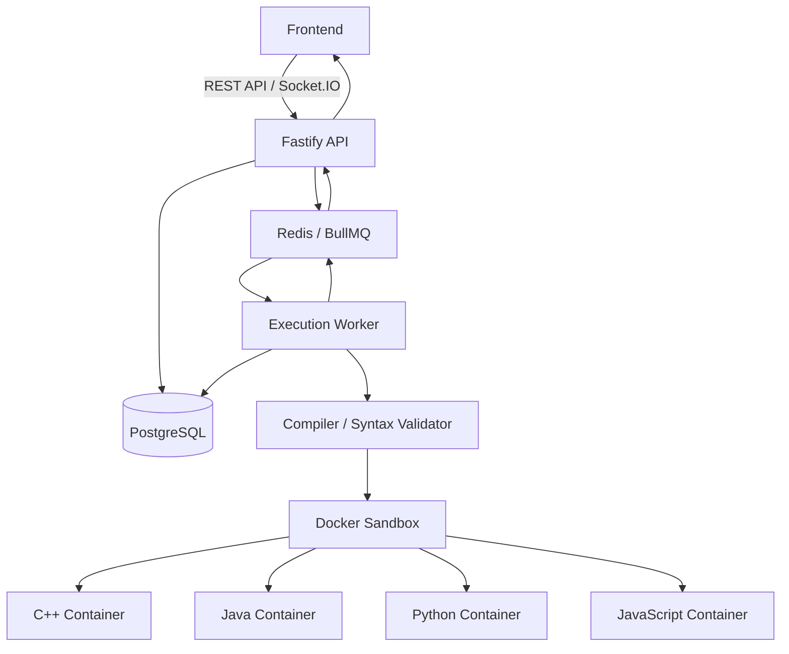

# 👨‍⚖️ Online Judge

A self-hosted online judge for submitting, compiling, and executing code in multiple programming languages inside isolated Docker containers.

The platform uses a dedicated asynchronous execution worker, Redis-backed job queues, and resource-limited Docker containers to evaluate submissions against predefined test cases.

## Features

- **Multi-language execution** — C++17, Java 21, Python 3, and JavaScript (Node.js).
- **Asynchronous execution** — Submission jobs are processed using BullMQ workers backed by Redis.
- **Docker sandboxing** — Each execution runs inside an isolated container.
- **Resource limits** — Configurable execution time, memory, process count, and output limits.
- **Verdict evaluation** — Automatic comparison of program output against expected test-case output.
- **Compilation and syntax validation** — Compilation errors are distinguished from runtime errors, including for interpreted languages.
- **Real-time updates** — Submission status updates are delivered to the frontend.
- **Persistent storage** — PostgreSQL stores users, problems, test cases, and submissions.
- **Database migrations and seeders** — Schema management and initial data population through MikroORM.

## Architecture

The application separates HTTP request handling from code execution.



### Submission lifecycle

1. The frontend submits source code to the backend.
2. The API creates a submission and adds an execution job to the BullMQ queue.
3. The dedicated worker consumes the job.
4. The appropriate language compiler or syntax validator prepares the execution command.
5. The Docker sandbox executes the program against the problem's test cases.
6. Execution results are evaluated and the final verdict is persisted.
7. Submission status updates are delivered to the frontend.

## Technology Stack

| Component               | Technology                   |
| ----------------------- | ---------------------------- |
| Backend                 | Node.js, TypeScript, Fastify |
| Frontend                | React, TypeScript, Vite      |
| Database                | PostgreSQL                   |
| ORM                     | MikroORM                     |
| Job Queue               | BullMQ                       |
| Queue Storage           | Redis                        |
| Code Execution          | Docker                       |
| Real-time Communication | Socket.IO                    |
| Package Manager         | pnpm                         |
| Testing                 | Vitest                       |
| Deployment              | Docker Compose               |

## Supported Languages

| Language   | Runtime / Compiler | Version    |
| ---------- | ------------------ | ---------- |
| C++        | GCC                | C++17      |
| Java       | OpenJDK            | Java 21    |
| Python     | CPython            | Python 3   |
| JavaScript | Node.js            | Node.js 24 |

## Execution and Sandboxing

Code execution is handled by a dedicated worker rather than the HTTP API process.

Each submission receives its own temporary workspace and executes inside a Docker container with restrictions such as:

- Network access disabled.
- Memory and CPU limits.
- Process count limits.
- Read-only root filesystem.
- Dropped Linux capabilities.
- No-new-privileges security option.
- Execution timeout enforcement.
- Output size limits.

The worker communicates with the host Docker daemon to create and remove execution containers.

The Docker socket is mounted into the worker only, not the API service.

## Verdicts

| Verdict               | Description                                       |
| --------------------- | ------------------------------------------------- |
| Accepted              | All test cases passed.                            |
| Wrong Answer          | Program output did not match the expected output. |
| Compile Error         | Compilation or syntax validation failed.          |
| Runtime Error         | Program terminated with an execution error.       |
| Time Limit Exceeded   | Execution exceeded the configured time limit.     |
| Memory Limit Exceeded | Execution exceeded the configured memory limit.   |

## Project Structure

```text
.
├── apps
│   ├── client
│   │   └── src/
│   └── server
│       ├── docker/
│       │   ├── cpp/
│       │   ├── java/
│       │   ├── javascript/
│       │   └── python/
│       ├── src/
│       │   ├── config/
│       │   ├── controllers/
│       │   ├── db/
│       │   ├── infrastructure/
│       │   ├── models/
│       │   ├── services/
│       │   └── workers/
│       └── tests/
├── docs/
├── infra/
├── docker-compose.yml
└── README.md
```

## Production Deployment

The production deployment uses prebuilt Docker images hosted on Docker Hub. You do not need Node.js, pnpm, or local image builds on the production host.

### Prerequisites

- Docker Engine
- Docker Compose plugin
- Git

### Docker Hub Images

The application publishes five Docker images:

| Image                    | Tag     | Purpose                                      |
| ------------------------ | ------- | -------------------------------------------- |
| `naman22a/oj-server`     | `1.0.0` | Backend API, worker, migrations, and seeders |
| `naman22a/oj-cpp`        | `1.0.0` | C++ execution environment                    |
| `naman22a/oj-java`       | `1.0.0` | Java execution environment                   |
| `naman22a/oj-python`     | `1.0.0` | Python execution environment                 |
| `naman22a/oj-javascript` | `1.0.0` | JavaScript execution environment             |

### 1. Clone the repository

```bash
git clone https://github.com/naman22a/oj.git
cd oj
```

### 2. Configure environment variables

Create the production environment file:

```bash
cp .env.example .env
```

Configure the required values:

- PostgreSQL credentials and connection URL.
- Redis connection.
- Authentication secrets.
- Administrator password.
- Docker socket group ID (`DOCKER_GID`).

Ensure that the database URL uses the Compose hostname `postgres` and Redis uses `redis`.

Generate strong authentication secrets before deployment.

### 4. Pull the production images

Pull the backend image:

```bash
docker pull naman22a/oj-server:1.0.0
```

Pull the language execution images:

```bash
docker pull naman22a/oj-cpp:1.0.0
docker pull naman22a/oj-java:1.0.0
docker pull naman22a/oj-python:1.0.0
docker pull naman22a/oj-javascript:1.0.0
```

These images must be available to the Docker daemon used by the execution worker.

### 5. Prepare the execution workspace

The worker uses a host-mounted directory to create temporary submission workspaces.

```bash
sudo mkdir -p /srv/oj/workspaces
sudo chown 10001:10001 /srv/oj/workspaces
sudo chmod 750 /srv/oj/workspaces
```

Set the Docker socket group ID in `.env`:

```bash
stat -c '%g' /var/run/docker.sock
```

Use the returned numeric value for `DOCKER_GID`.

### 6. Start the production deployment

Pull the infrastructure images and start the application:

```bash
docker compose -f docker-compose.yml pull
docker compose -f docker-compose.yml up -d
```

The Compose deployment starts:

- PostgreSQL
- Redis
- Database migrations
- Database seeders
- Fastify API
- Execution worker

Migrations and seeders run as one-shot services before the API and worker start.

### 7. Verify the deployment

Check service status:

```bash
docker compose -f docker-compose.prod.yml ps
```

Inspect application logs:

```bash
docker compose -f docker-compose.prod.yml logs -f api worker
```

Check the API health endpoint:

```bash
curl http://127.0.0.1:5000/api/health
```

The API is bound to localhost on port `5000`, ready to be exposed through a reverse proxy.

## Development

The backend and frontend can also be developed independently.

Install backend dependencies:

```bash
cd apps/server
pnpm install
```

Run backend tests:

```bash
pnpm exec vitest run
```

For frontend development:

```bash
cd apps/client
pnpm install
pnpm dev
```

Refer to the application configuration and environment examples for the required development settings.

## Testing

The backend uses Vitest for automated testing.

The test suite covers components including:

- Compiler implementations.
- Docker sandbox behavior.
- Execution pipeline.
- Submission processing.
- Queue and worker integration.
- Submission status transitions.
- Worker failure and retry handling.

Run the backend test suite:

```bash
cd apps/server
pnpm test
```

## Security Considerations

Executing untrusted code requires strict isolation.

This project uses Docker containers with resource and privilege restrictions. The execution worker has access to the host Docker socket, which grants substantial control over the host.

**Only run this deployment on a trusted host with appropriate access controls.** The Docker sandbox is a security boundary that should be reviewed and hardened before exposing the service to untrusted public traffic.

## License

This project is licensed under the MIT License. See [LICENSE](LICENSE) for details.
